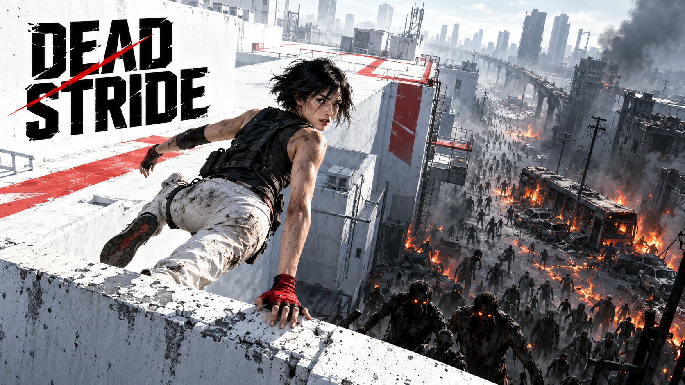

Parkour and round-based zombies, inspired by Mirror's Edge and Black Ops II.

Round 43 is a bad time to discover the street is a dead end. The idea behind DEAD STRIDE is to give that zombie train somewhere else to go: over a wrecked bus, through a second-floor window and out across the rooftops.

I want landing the jump to feel as good as surviving the round. And I want a missed jump to leave you scrambling for another route, with your friends yelling directions and the horde catching up.

### Where I want to take it

- **Co-op for up to four.** Split the horde, cover a crossing, or double back for someone who went down. A good rescue should be worth remembering.
- **A crew with some personality.** Four original runners with distinct looks and voices, sharing the same movement fundamentals. Your favourite character should feel right without needing a speed advantage.
- **Maps you learn by surviving them.** Open shortcuts, reconnect rooftops and work out which window gets you home. Familiar streets should offer better routes as you get better at moving.
- **Zombies that can ruin your favourite route.** A few climbers and fast interceptors mixed into the crowd, so reaching a roof buys time without ending the chase.
- **Reasons to come back.** High-round runs, timed rooftop routes, hidden map objectives and outfits earned through play.

The first map idea is **Dead Block**: a burning intersection, a stranded bus and a ring of connected rooftops. Small enough to learn, with enough crossings to make splitting up a real decision.

[Gameplay notes](GAMEPLAY.md) · [Suggest a runner, route or map](https://github.com/bonnyxen/dead-stride/issues)
