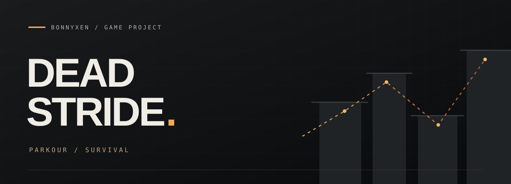

  

<strong>First-person parkour meets wave-based zombie survival.</strong>

---

A ruined city. A growing horde. One more way across.

DEAD STRIDE explores a survival loop built around movement: vaulting wrecked cars, crossing rooftops, and finding a route before the street closes in.

### Design focus

- **Movement under pressure.** Short routes should demand commitment; longer routes should give the player room to recover.
- **A city worth learning.** Streets, ledges, and rooftops should connect into routes the player can recognize and improve.
- **Waves that change the route.** More enemies should make familiar crossings harder to use.

### Project notes

[Design direction and next steps →](DESIGN.md)

---

A project by <a href="https://github.com/bonnyxen">bonnyxen</a>

